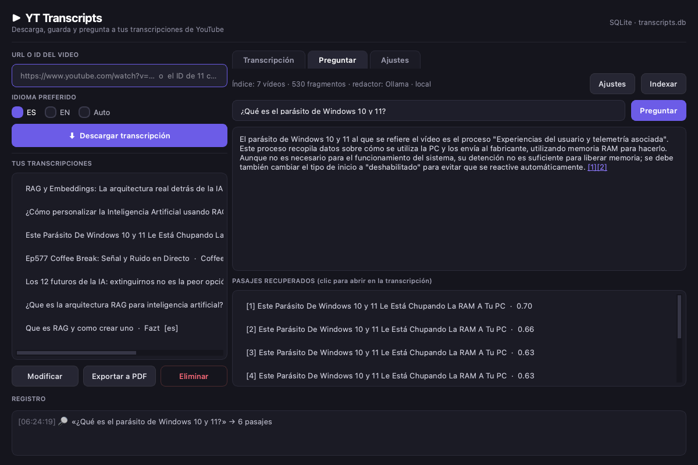

# YT Transcripts

Aplicación de escritorio (PySide6/Qt) para descargar transcripciones de YouTube,
leerlas con comodidad y **preguntarles** con búsqueda semántica local y respuestas
citadas. Todo el texto y el índice viven en un único archivo SQLite en tu equipo.



## Qué hace

- **Descargar** la transcripción de un vídeo de YouTube a partir de su URL o ID
  (español, inglés o automático), con una pausa de seguridad entre descargas.
- **Guardar** la biblioteca en `transcripts.db` (SQLite), ordenada por fecha.
- **Leer** con tamaño de letra ajustable, enlace al vídeo en el navegador y
  exportación a PDF.
- **Preguntar**: índice semántico local (embeddings ONNX) + redactor opcional
  que responde citando los pasajes, con las citas clicables.
- **Elegir la IA**: sin IA (solo pasajes), DeepSeek en la nube u Ollama en local.

## Requisitos

- macOS (Apple Silicon) para la app empaquetada de este repositorio.
- Python 3.12+ si trabajas desde el código.
- Opcional: [Ollama](https://ollama.com) para redactar respuestas en local.
- Opcional: clave de API de [DeepSeek](https://platform.deepseek.com) para la nube.

## Uso rápido

1. Pega la URL del vídeo y pulsa **Descargar transcripción**.
2. Selecciona la transcripción en la lista para leerla.
3. En la pestaña **Preguntar**, pulsa **Indexar** una vez (la primera vez descarga
   un modelo de ~240 MB) y después escribe tu pregunta.
4. En **Ajustes** eliges el redactor, la clave API, el tamaño de letra y los datos
   del índice.

La guía completa para usuarios está en
[Guia-de-uso-YT-Transcripts.docx](Guia-de-uso-YT-Transcripts.docx) (y en PDF junto
al ejecutable).

## Cómo funciona el RAG

```
transcripts → chunks (~900 caracteres) → embeddings locales ONNX (384 dims)
                                                      ↓
pregunta → embedding → coseno top-6 → pasajes → redactor (IA) → respuesta [1] [2]
                                                      ↘ sin redactor: solo pasajes
```

- **Índice**: tablas `chunks`, `chunk_vec` y `rag_meta` dentro de `transcripts.db`.
  Se actualiza de forma incremental (hash del contenido + nombre del modelo).
- **Embeddings**: `paraphrase-multilingual-MiniLM-L12-v2` (fastembed/ONNX, 384
  dimensiones, 50 idiomas), ejecutado en CPU, sin conexión.
- **Redactor**: cualquier API compatible con OpenAI. Por defecto DeepSeek
  (`deepseek-chat`); también Ollama (`http://localhost:11434/v1`) u otro servicio.
- **Citas**: cada `[n]` es un enlace que abre la transcripción y resalta el pasaje.

### IA local con Ollama

```bash
ollama pull qwen2.5:7b-instruct   # ~4,7 GB
ollama serve
```

Después, en **Ajustes** → Redactor: «Ollama · local» → **Detectar** → elegir el
modelo → **Probar conexión** → **Guardar**.

## Datos y privacidad

| Archivo | Contenido |
|---|---|
| `transcripts.db` | transcripciones, índice semántico y control de cambios |
| `rag_config.json` | redactor, dirección, modelo y clave API (si hay) |
| `ui_config.json` | preferencias de interfaz (tamaño de letra) |
| `models/` | modelo de embeddings descargado en la primera indexación |

Sin redactor, o con Ollama, **nada sale del equipo**: solo se descargan subtítulos
de YouTube cuando lo pides. Con un redactor en la nube se envían la pregunta y los
seis pasajes recuperados, nunca la base de datos completa.

## Desarrollo

```bash
python -m venv .venv
.venv/bin/python -m pip install -r requirements.txt

.venv/bin/python BuscadorYT.py        # abrir la aplicación
.venv/bin/python rag.py index         # indexar por consola
.venv/bin/python rag.py search "consulta" -k 6
.venv/bin/python rag.py stats
```

### Compilar

macOS, en local:

```bash
PYINSTALLER_CONFIG_DIR="$PWD/.pyinstaller-cache" \
  .venv/bin/pyinstaller --clean --noconfirm BuscadorYT.spec
# → dist/BuscadorYT
```

Windows 10+: PyInstaller no cross-compila, así que se compila en GitHub Actions
(`windows-latest`, ver `.github/workflows/build.yml`) o en una máquina Windows.
El ejecutable queda en `dist/BuscadorYT.exe`.

## Estructura

| Archivo | Responsabilidad |
|---|---|
| `BuscadorYT.py` | interfaz, SQLite, descarga de subtítulos, exportación a PDF |
| `rag.py` | troceado, embeddings, índice, búsqueda y llamada al redactor |
| `BuscadorYT.spec` | receta de empaquetado con PyInstaller |
| `make_guia.py` | genera la guía de uso (DOCX → PDF) |
| `RAG.md` | documentación técnica del índice y de los proveedores de IA |

## Licencias

| Componente | Licencia |
|---|---|
| PySide6 / Qt | LGPL-3.0 |
| reportlab | BSD |
| youtube-transcript-api | MIT |
| fastembed | Apache-2.0 |
| onnxruntime | MIT |
| numpy | BSD |
| Modelo MiniLM (paraphrase-multilingual) | Apache-2.0 |
